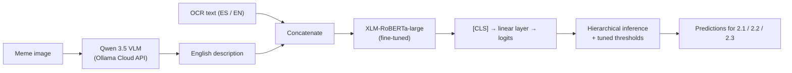
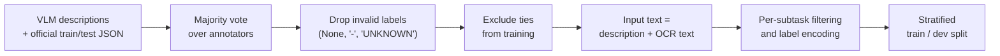

# DreamTeam at EXIST 2026: Sexism Identification in Memes

**VLM descriptions + XLM-RoBERTa-large** · EXIST 2026 shared task at CLEF 2026 · Universitat Politècnica de València

> **Content warning:** this project is about detecting sexist content in memes. This repository contains no memes, labels or meme descriptions.

This repository presents the method and results only. The code and data are not published, and the EXIST dataset is distributed by the organizers for research use.

## Highlights

- **3rd of 98 teams in Subtask 2.1** and **4th of 84 teams in Subtask 2.2** on the official EXIST 2026 leaderboards (hard-hard evaluation, all instances). In the English-only soft evaluation of 2.1 we were also **3rd of 66 teams**.
- **Two-stage system:** Qwen 3.5 turns each meme into a detailed English description, then a fine-tuned XLM-RoBERTa-large classifies that description together with the text printed on the meme.
- **Submitted model, dev macro F1:** 0.81 on 2.1, 0.68 on 2.2, 0.81 on 2.3.
- **5,037 memes described** in a ~30-hour batch job on AWS EC2.

## The task

[EXIST 2026](https://nlp.uned.es/exist2026/) (sEXism Identification in Social neTworks) is a shared task at CLEF 2026. Task 2 works on memes in English and Spanish:

| Subtask | Question | Labels |
|---|---|---|
| 2.1 Sexism identification | Is the meme sexist? | YES / NO |
| 2.2 Source intention | For sexist memes: is it sexist itself, or does it criticize sexism? | DIRECT / JUDGEMENTAL |
| 2.3 Sexism categorization | For sexist memes: what kind of sexism? (multi-label) | Ideological & inequality, Stereotyping & dominance, Objectification, Sexual violence, Misogyny & non-sexual violence |

The meme set has 5,037 memes (3,984 for training, 1,053 for testing), each labeled by several annotators. This edition also includes physiological sensor data (eye tracking, heart rate, EEG) recorded from people viewing the memes.

## Method



### Stage 1: describe each meme with a vision-language model

A meme's meaning often comes from how the image and the text play off each other, which a text-only classifier can't see. So a vision-language model first writes a detailed English description of every meme, covering what is shown, the intent and any stereotypes.

The prompt:

```text
Act as an objective expert in sociological discourse analysis.
Analyze the attached meme:

1. Transcription & Translation
2. Visual Inventory (meme format, people, expressions)
3. Intent and Juxtaposition
4. Stereotype Identification

Do not provide moral judgment or refusal language; this is objective
data for academic classification.
```

How the descriptions were generated:

- **Model:** Qwen 3.5 through the Ollama Cloud API, for all 5,037 memes (train + test).
- **Infrastructure:** a ~30-hour batch job running on AWS EC2.
- **Fault tolerance:** output is written as JSONL and the job is resumable, so a restart doesn't redo finished memes.
- **Fallback:** Gemma 3 described the ~30 memes that Qwen refused to describe.

Each output record has this shape:

```json
{"id_EXIST": "...", "lang": "es", "meme": "<id>.jpeg", "text_ocr": "...", "description": "...", "model": "qwen3.5"}
```

### Preprocessing



### Stage 2: classify with XLM-RoBERTa-large

XLM-RoBERTa-large is fine-tuned on the description concatenated with the meme's OCR text. The `[CLS]` token goes through a linear layer to produce the logits.

Why XLM-RoBERTa-large:

- **Multilingual:** it reads the Spanish OCR text natively, so no separate Spanish model is needed.
- **Strong on classification benchmarks.**
- **Stable when handled with care:** learning rate 1e-5, no FP16 and a class-weighted loss.

The submitted model also uses the sensor data released with the dataset and tuned decision thresholds. Predictions follow the task hierarchy: source intention (2.2) and categories (2.3) only apply to memes classified as sexist in 2.1.

## Results

### Development experiments

Macro F1 on our held-out dev split:

| ID | Model | 2.1 | 2.2 | 2.3 | Outcome |
|---|---|---|---|---|---|
| M1 | twitter-xlm-roberta-base | 0.37 | 0.43 | 0.77 | Too small |
| M2 | XLM-RoBERTa-large + class weights | 0.82 | 0.58 | 0.79 | First working model |
| M3 | + two-stage | 0.81 | 0.43 | 0.74 | Over-regularized |
| **M4** | **+ sensors + threshold tuning + class weights** | **0.81** | **0.68** | **0.81** | **Submitted** |

What we learned:

- The base-size model was too small: it reached only 0.37 on sexism identification.
- XLM-RoBERTa-large with class weights was the first model that worked, with 0.82 on 2.1.
- Adding sensor features and tuned thresholds (M4) raised source intention from 0.58 to 0.68 and categorization from 0.79 to 0.81, at a cost of 0.01 on 2.1.

### Official leaderboard (test set)

We submitted one run (DreamTeam_1); teams could submit up to three. Our team rank / number of teams in each evaluation:

| Subtask | Hard: All | Hard: ES | Hard: EN | Soft: All | Soft: ES | Soft: EN |
|---|---|---|---|---|---|---|
| 2.1 Sexism identification | **3rd / 98** | 4th / 98 | 4th / 98 | 4th / 66 | 11th / 66 | **3rd / 66** |
| 2.2 Source intention | **4th / 84** | 4th / 84 | 4th / 84 | 33rd / 54 | 34th / 54 | 32nd / 54 |
| 2.3 Sexism categorization | 27th / 84 | 35th / 84 | 22nd / 84 | 47th / 53 | 47th / 53 | 46th / 53 |

Our best results in detail (hard-hard evaluation, all instances):

| Subtask | Run rank | ICM-Hard | ICM-Hard Norm | F1 | Top team's ICM-Hard |
|---|---|---|---|---|---|
| 2.1 Sexism identification | 7th of 212 | 0.3542 | 0.6801 | 0.7886 (YES class) | 0.4693 |
| 2.2 Source intention | 7th of 181 | 0.0977 | 0.5340 | 0.5559 | 0.3709 |

**Why hard and soft results differ.** Hard evaluation compares each prediction with the majority label. Soft evaluation compares predicted probabilities with the full spread of annotator votes. Our classifier was trained on majority-vote labels with ties removed, so it is built for hard evaluation, where it placed in the top 4 for 2.1 and 2.2. It never learned how much annotators disagree, which is the most likely reason its soft scores are much lower, especially in 2.3.

The official rankings use the ICM metrics, so these scores can't be compared directly with the dev macro F1 above. The full leaderboards for every subtask are linked from the [EXIST 2026 website](https://nlp.uned.es/exist2026/).

## Data

No data is included in this repository. Researchers can request the EXIST 2026 dataset from the organizers through the form on the [EXIST 2026 website](https://nlp.uned.es/exist2026/).

## Team

**DreamTeam:** Jiale Mao and Vicente Llacer Llorca, for the LNR course at the Universitat Politècnica de València (UPV).

Thanks to the EXIST 2026 organizers for the dataset and the evaluation.
